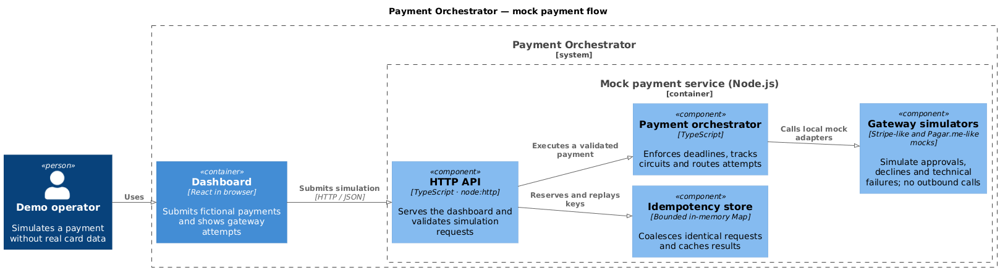

# Payment Orchestrator

A local payment **simulator**, not a payment processor. A React dashboard
submits fictional Pix or card payments to a TypeScript API. The API tries a
primary mock gateway and a fallback and returns the outcomes and timings.
No money moves, no real provider is contacted, and card numbers are not
accepted. Do not expose this unauthenticated demo to the public internet or
send real payment data.

## Architecture and stack



- Node.js 24 and TypeScript, using built-in HTTP and the Node test runner.
- React 19 and esbuild for the same-origin dashboard.
- ESLint, TypeScript checking, GitHub Actions, and a non-root Docker image.

`backend/http.ts` validates incoming requests and serves the dashboard.
`backend/idempotency.ts` handles request coalescing, and
`backend/payment_orchestrator.ts` handles mocked gateway calls and circuit
state. Each attempt has a two-second deadline. Three consecutive technical
failures open a circuit for 15 seconds, after which it admits one recovery
probe. Business declines do not open the circuit. Both mocks are in-process
and use randomized outcomes; automated tests inject deterministic gateways.

The [C4 source](docs/architecture.puml) can be rendered with
`java -jar plantuml.jar -tpng docs/architecture.puml`.

## Local setup

Prerequisites: Git, Node.js 24, and npm. Docker Engine with the Compose plugin
is optional.

```sh
npm ci
cp .env.example .env
npm run build
npm start
```

Open <http://127.0.0.1:3000/> for the dashboard or
<http://127.0.0.1:3000/health> for API liveness. Rebuild after frontend or
backend edits. No accounts, database, secrets, or migrations are required.

| Variable | Default | Purpose |
| --- | --- | --- |
| `HOST` | `127.0.0.1` | Native bind address (IP address or `localhost`). The Docker service binds to all interfaces *inside the container*, with its published port restricted to host loopback. |
| `PORT` | `3000` | Native port, 1–65535. Compose uses it as the host-side port; the container listens on 3000. |

With Docker:

```sh
docker compose up --build --wait
curl --fail http://127.0.0.1:3000/health
docker compose down
```

## Request a simulation

```sh
curl -i http://127.0.0.1:3000/api/v1/payments/process \
  -H 'Content-Type: application/json' \
  -H 'Idempotency-Key: demo-order-1' \
  -d '{"amount":25.00,"currency":"BRL","method":"PIX"}'
```

`amount` must be from 0.01 through 1,000,000 with at most two decimal places.
`currency` accepts `BRL` (default), `USD`, or `EUR`; `method` accepts
`PIX` or the mock `CREDIT_CARD` option. Clients of the original demo must
remove `cardNumber` and any other extra fields. JSON requests are capped
at 16 KiB.

The API returns `200` for approval, `402` for a simulated business
decline, `503` for unavailable gateways or a full idempotency cache,
`409` for conflicting key reuse, and `400`, `413`, or `415` for invalid
requests. Gateway responses include the ordered attempt history.

`Idempotency-Key` is optional (1–128 letters, digits, or `._:-`).
Concurrent requests with the same key and normalized payload share one
execution. Requests with different payloads conflict during execution and
for five minutes after it finishes. At most 1,024 entries are retained in
one Node process. The cache does not persist through restarts or coordinate
across replicas; it is not a production payment deduplication guarantee.

## Quality checks

```sh
npm run lint
npm run typecheck
npm test
npm run build
npm audit
```

CI runs lint, type checking, tests, the production build, and a container
smoke check on pushes and pull requests.